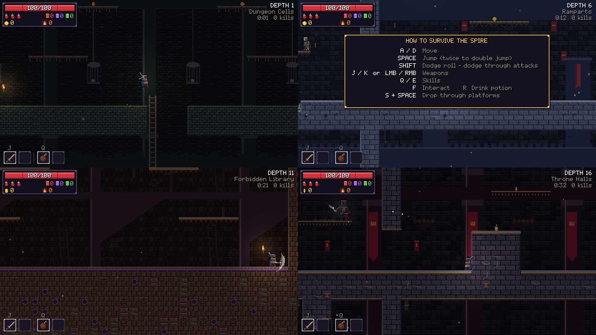

# Hollow Spire

A browser-based 2D action roguelite. Descend a procedurally generated castle,
cut through its guardians, gather powerups and coins, and spend what you earn
on permanent upgrades before the next attempt. Each floor is harder than the
last. **Your score is how deep you got before you fell.**



Built with Phaser 3, TypeScript and Vite. Every sprite, tile, sound effect and
music track is generated from code. There are no asset files.

## Play

```bash
npm install
npm run dev        # http://localhost:5173
```

Production build: `npm run build`, then `npm run preview`.

### Controls

| Action | Keyboard | Mouse | Touch |
|---|---|---|---|
| Move / climb | `A` `D` / arrows, `W` `S` on ladders | | Left-side joystick |
| Jump / double jump / wall jump | `Space` or `Z` | | Jump button |
| Drop through platform | `S` + `Space` | | Stick down + jump |
| Weapon 1 / weapon 2 | `J` / `K` | Left / right click (aims at the cursor) | A / B buttons |
| Dodge roll (invulnerable) | `Shift` or `L` | | Dodge button |
| Skill 1 / skill 2 | `Q` / `E` | | Q / E buttons |
| Interact | `F` or `Enter` | | Interact button |
| Health potion | `R` | | Potion button |
| Pause | `Esc` or `P` | | Pause button |

## How a run works

- **Floors** are built from hand-authored room templates on a randomly
  generated grid. Every floor has combat rooms, a treasure room, a merchant,
  scroll altars and an exit portal. A reachability checker guarantees that
  every floor can be completed.
- **Biomes** change every 5 floors: the Dungeon Cells, the Ramparts, the
  Forbidden Library and the Throne Halls. A **boss** guards every 5th floor.
  After floor 20 the cycle repeats with harsher Ascension scaling, so depth
  is unlimited.
- **Difficulty** rises with depth. Enemy health and damage grow every floor,
  there are more enemies per room, and elites become more common. Elites come
  in swift, armored, vampiric, explosive and frenzied variants.
- **Powerups**:
  - Two weapon slots and two skill slots.
  - Passive relics.
  - Scrolls that raise Might, Cunning or Vigor and scale everything tied to
    that stat.
  - Items drop in four rarities, from Common to Legendary, with random
    affixes.
- **Currencies**:
  - **Coins** are kept when you die. You can spend them at in-run merchants
    or save them for the Sanctum.
  - **Embers** drop from elites and bosses. They are only kept once you bank
    them at a floor exit; unbanked embers are lost when you die. Embers
    unlock new items in the Armory.
- **The Sanctum** is where you go between runs:
  - Buy permanent upgrades.
  - Unlock new weapons, skills and relics into the drop pool.
  - Choose your starting loadout.
  - Buy cosmetic cloaks.
  - Review your best runs.

## Development

```bash
npm run typecheck   # TypeScript, strict
npm test            # Vitest unit tests (generation, loot, economy, saves...)
npm run e2e         # Playwright end-to-end tests (builds, then drives the game)
```

Add `?debug=1` to the URL to expose `window.__spire` with these helpers:
`warp(n)`, `god()`, `spawn(id)`, `give(id)`, `equip(id)`, `killAll()`, `die()`
and `state()`. Two URL parameters also work: `&start=game|sanctum` skips
menus and `&floor=N` starts on floor N.

### Project layout

```
src/
  art/        code-generated sprites, tilesets, backgrounds, fonts (TextureFactory)
  core/       rng, save system, event bus, input (keyboard/mouse/touch), audio synth
  data/       weapons, skills, relics, affixes, enemies, bosses, meta upgrades
  world/      floor generator, room templates, reachability validator, difficulty
  entities/   player, enemies + AI brains, bosses, projectiles, pickups, interactables
  combat/     damage, weapons/skills runtime, game-feel (hitstop, shake, particles)
  run/        run state, stats, loot, economy
  scenes/     Boot, Title, Sanctum, Game, HUD, modals, Pause, Settings, Death
  ui/         UI widgets
tests/unit    Vitest
tests/e2e     Playwright
```

### Deployment

`.github/workflows/ci.yml` runs the type check, unit tests, build and
end-to-end tests on every push. Pushes to `main` are also published to GitHub
Pages. To turn this on, go to **Settings → Pages** and set the source to
**GitHub Actions**.
